# Back2U 🔎

An AI-powered lost-and-found web app built on AWS. People report lost or found items with a photo, and Back2U analyses each photo with computer vision, blurs any personal information, and ranks likely matches for staff to confirm.

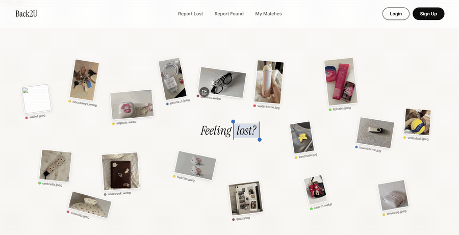

**Demo video:** https://youtu.be/I4kBpG60UOk

## The Problem

Most lost-and-found services are still a list you have to keep checking. At NUS, you search a public Found Items list and email the office if your item is there. SBS Transit publishes a similar list of found items with a claim deadline. Informal channels fill the gap, but NUS's Lost and Found Telegram channel has seen people post full names, ID numbers and student numbers, so users have to be reminded about the PDPA.

None of these match items by what they look like. A list only helps if you keep checking it, and a chat only helps if the right person happens to be scrolling. Losing things is also common. One survey found people lose around 5 items a month and spend close to 17 hours a year looking for them (Life360, 2024). Automated matching can make a real difference. After Irish Citylink moved to a system with image capture and automated matching, it returned about 33% of logged items, while transport operators rarely beat 20% (NotLost, 2025).

Back2U started as "FindIt" in my project proposal. Members of the public report what they lost or found, and staff at schools and public venues review matches and handle the handover. Reports are never posted publicly. Matching runs in the background, and staff make the final call.

## Screenshots

| | |
|---|---|
| 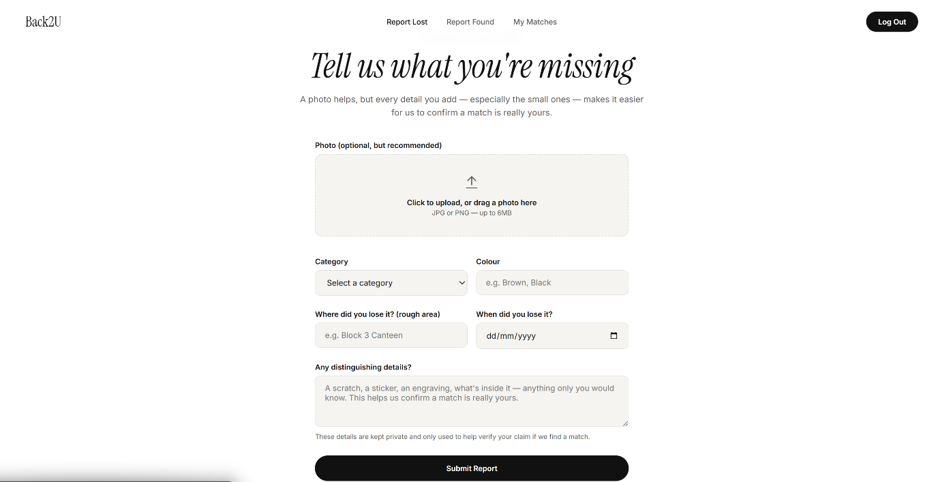 <br> *Reporting a lost item* | 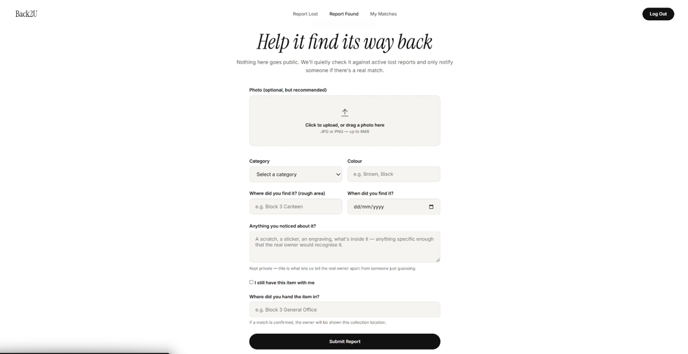 <br> *Reporting a found item, with a handover point* |
| 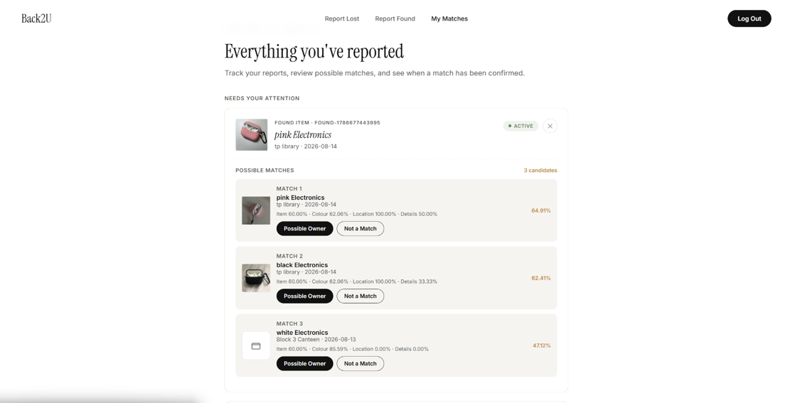 <br> *Ranked candidates with their four scores* | 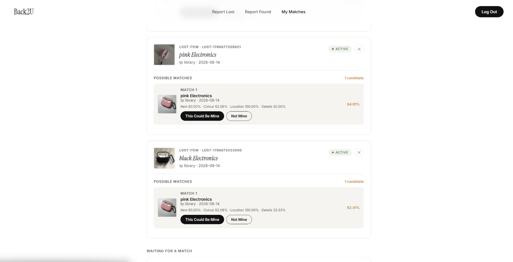 <br> *The owner's side of the same match* |
| 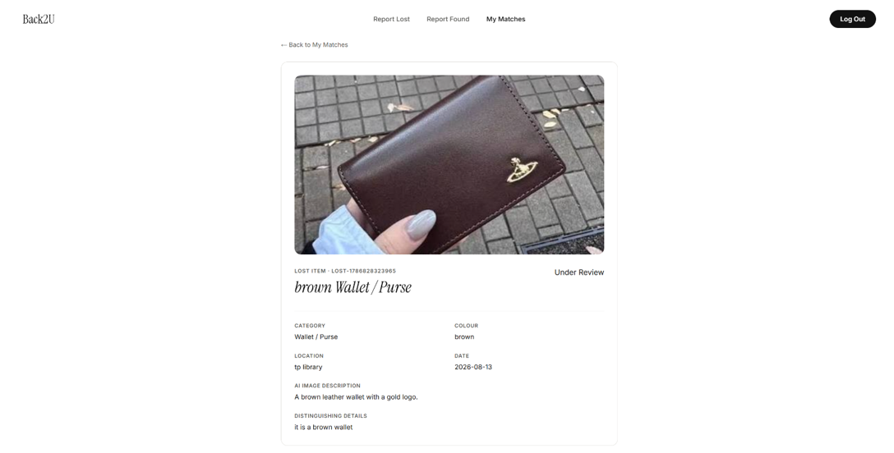 <br> *Report details with the Bedrock description* | 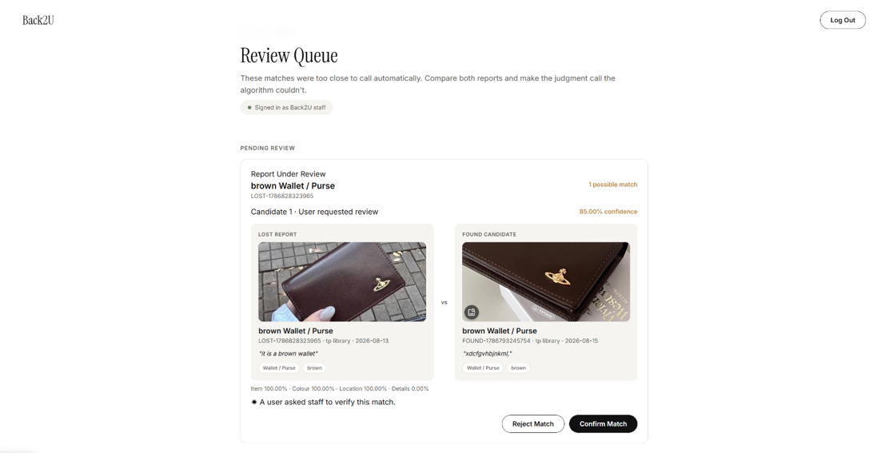 <br> *Staff comparing a lost report with a found candidate* |
| 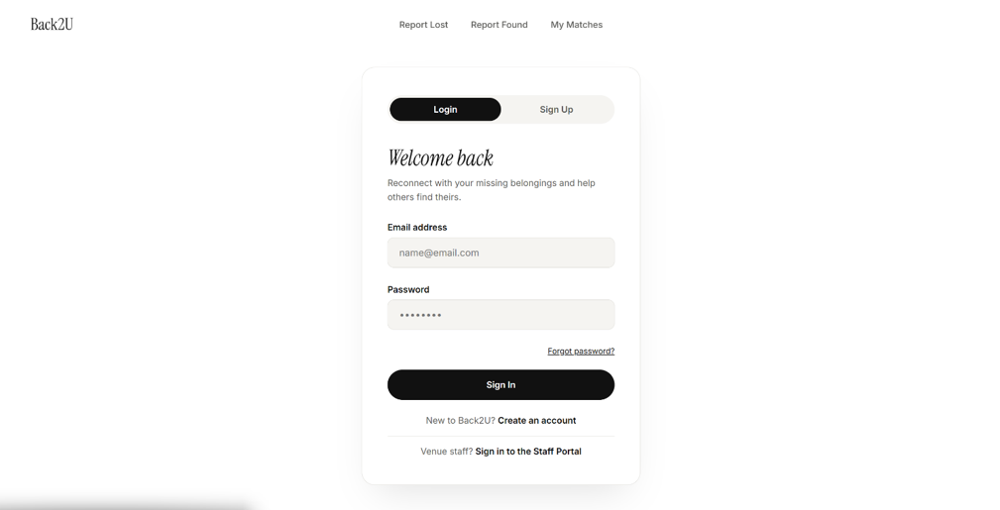 <br> *Sign in with Cognito* | 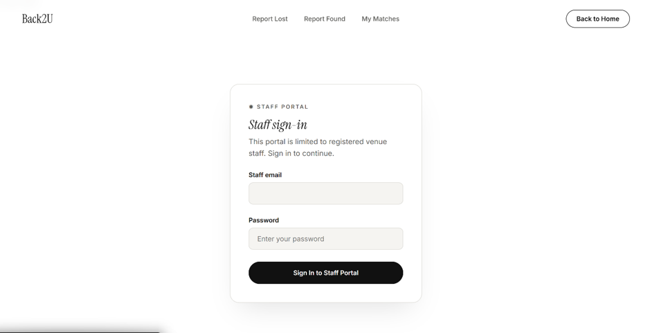 <br> *Separate staff portal, limited to the staff group* |

## How It Works

1. **A user reports a lost or found item** with a photo, category, colour, area, date and details.
2. **The photo is analysed.** Rekognition detects labels and the item's colour, and my Custom Labels model classifies the item.
3. **Personal information is blurred.** Faces, NRIC/FIN numbers, emails, Singapore phone numbers and identity documents are detected and blurred in a separate copy of the photo.
4. **Bedrock describes the item.** If the photo needed no blurring, Amazon Nova Lite writes a one-sentence description of it.
5. **Matching runs automatically.** Once the report is saved, it is scored against every active report of the opposite type, and the top 5 candidates are saved.
6. **A user requests a review.** Either person in a match can send the candidate that looks right to staff.
7. **Staff confirm or reject.** Staff can confirm the user's pick or another suggested candidate. Once confirmed, both reports are marked resolved and an email notification goes out through SNS.

## Architecture

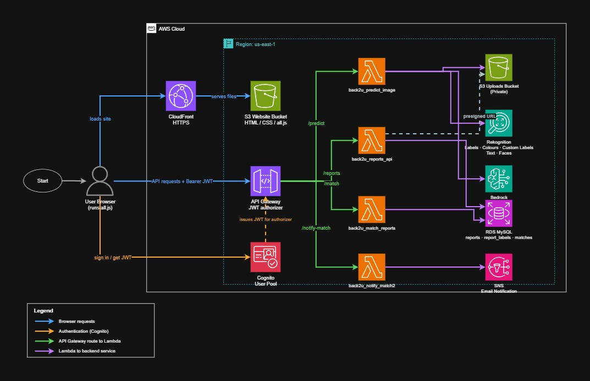

Everything regional runs in us-east-1.

| Service | What it does |
|---|---|
| CloudFront | Serves the website over HTTPS |
| S3 | One bucket for the website files, and a separate private bucket for uploaded photos and their blurred copies |
| Cognito | User and staff sign-in. Staff are a Cognito group |
| API Gateway | HTTP API with a Cognito JWT authorizer that checks the token before a request reaches Lambda |
| Lambda | Four Python functions for image analysis, reports, matching and notifications |
| Rekognition | Labels, foreground colour, text detection and face detection |
| Rekognition Custom Labels | A model I trained to classify 8 types of lost items |
| Bedrock (Amazon Nova Lite) | A one-sentence item description, only for photos with no personal information |
| RDS (MySQL) | Three tables: reports, report labels and matches |
| SNS | Email notification when staff confirm a match |

## Matching

Each candidate gets four scores out of 100, which combine into one weighted score:

| Score | Weight | How it is calculated |
|---|---|---|
| Item | 50% | The best of three: both photos got the same Custom Labels class (70 plus up to 30 based on confidence), both reports have the same category (60), or the overlap between their Rekognition labels |
| Colour | 20% | Distance between the two detected RGB colours. If a report has no detected colour, it scores 70 when both users typed the same colour |
| Location | 15% | Word overlap between the two areas |
| Details | 15% | Word overlap between the two descriptions |

Two rules filter out candidates before scoring. A found item cannot have been found before the lost item went missing, and the two reports must share at least one sign of being the same kind of item: the same category, the same Custom Labels class, or a shared Rekognition label.

## Privacy and Security

- The uploads bucket has Block Public Access on. Regular users only ever get the **blurred copy** of a photo, through a presigned link that expires after 5 minutes.
- Only staff can see the original photo, which they need to verify a claim.
- Users can only open their own reports. They can view the blurred photo of a report that has been matched with theirs.
- If a photo looks like an identity document, all text in it is blurred, not just the parts that match a pattern.
- Bedrock is skipped for any photo that needed blurring, so those photos are never sent to the model.
- The server takes the user ID from the signed-in token, never from the browser. Staff-only actions are checked again in Lambda, not just in the page.
- The Lambda functions use a separate MySQL account that can only select, insert, update and delete. It cannot change tables or manage users.
- Each Lambda role has its own scoped IAM policies. For example, the Bedrock policy only allows Nova Lite, and the SNS policy only allows publishing to the Back2U topic.
- The match email contains no item details.
- Text that users type is escaped before it is shown on a page, so it cannot run as code.

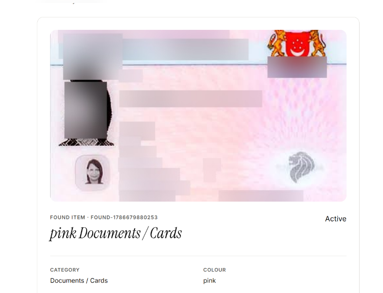

*A sample identity card after redaction. The main photo and the text are blurred, but the small secondary photo at the bottom left was missed, which shows face detection does not catch every face.*

## What I Learned

**A perfect test score can still mean a weak model.** I built a Custom Labels dataset of 623 images across 8 classes: airpods, bag, keys, laptop, phone, umbrella, wallet and water bottle. AWS's evaluation gave every class a precision, recall and F1 of 1.000. On new real photos, the model still picked the right class, but with much less confidence. One AirPods photo scored 52.4% airpods and 30.7% keys, and a Snoopy AirPods case scored only 40.2%. I collected the training images from Google Images using the Fatkun downloader, so most were clean product photos, so the test set was too similar to the training set. Real users upload phone photos with cluttered backgrounds and different lighting. So I kept Custom Labels as one supporting signal instead of relying on it alone.

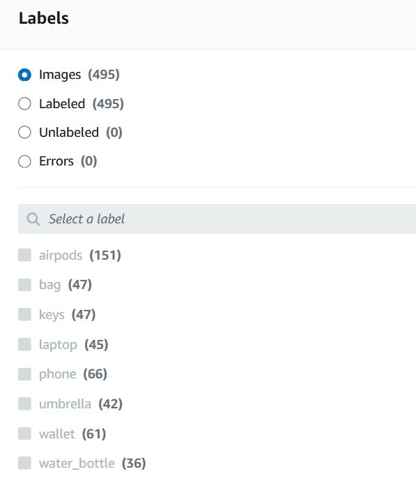 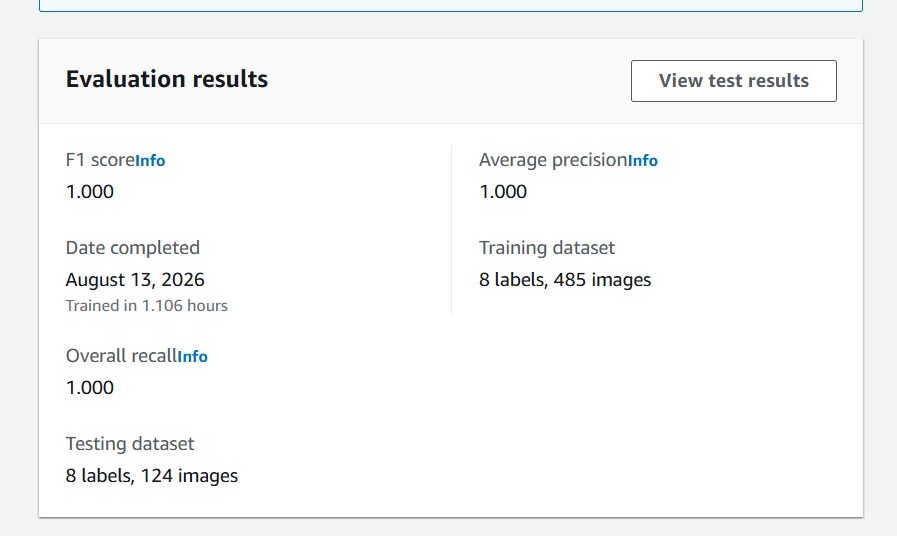

*The dataset classes and the F1 1.000 evaluation*

**The bug was in my code, not in Rekognition.** A pink water bottle kept coming back as grey. When I printed the raw colours, the biggest single cluster was actually rosybrown at 24.3%. My code was grouping colours by Rekognition's simplified names, so silver, darkgrey, gainsboro and other greys all merged into one grey at about 74%. I first switched to foreground colours, then kept the raw RGB values and added an `is_neutral()` check so the app picks the strongest non-grey colour. In a later test, a blue wallet came out as blue RGB (95, 158, 160) even though grey covered 78.9% of the summary.

**General labels are noisy.** A set of house keys came back as Key at 95.9%, but also Gun and Weapon at 77.1%. An iPad covered in stickers came back as Animal, Dog, Person and Photo Frame before Electronics. I added a blocklist for weapon labels, and lowered MinConfidence from 70 to 60 with up to 20 labels so useful labels were not lost. Bedrock helped where labels could not. For the Snoopy case, Rekognition only said Accessories, Jewelry, Locket and Pendant, while Nova Lite said "Blue case with a cartoon dog on it".

**Design for parts being switched off.** A Custom Labels model is charged for every hour it runs, so I only started it for testing and demos. When it is stopped, the Lambda catches the error and returns `custom_model_status = "stopped"`, and the rest of the image analysis still works.

**IAM permissions are per action.** Adding DetectText and DetectFaces to my code did nothing until I added those exact actions to the Lambda role. CloudWatch named the denied action, which made it quick to fix.

## Design Decisions

- **No chat between users.** I removed the chat feature because staff handle the handover, so the owner and finder never need to contact each other directly.
- **One report, several candidates.** Matching is one to many. Each report keeps a ranked list of candidates instead of a single guess, and staff can confirm a different candidate from the one the user picked.
- **One Lambda per job.** Image analysis, reports, matching and notifications are separate functions, because each needs different AWS permissions and libraries.

## Project Structure

```
frontend/      HTML pages, style.css and all.js
lambda/        predict_image.py, reports_api.py, match_reports.py, notify_match.py
database/      back2u_schema.sql
screenshots/   images used in this README
```

## Setup

1. Create the database with `database/back2u_schema.sql`.
2. Create each Lambda function from the files in `lambda/`. `predict_image.py` needs Pillow, and `reports_api.py` and `match_reports.py` need PyMySQL. I added both as Lambda layers. I also raised `predict_image` from 128 MB and 3 seconds to 256 MB and 15 seconds, because it does a lot of work per photo.
3. Set these environment variables on the Lambda functions:

| Variable | Used by |
|---|---|
| `DB_HOST`, `DB_USER`, `DB_PASSWORD`, `DB_NAME` | reports_api, match_reports |
| `UPLOAD_BUCKET` | predict_image, reports_api |
| `CUSTOM_MODEL_ARN` | predict_image |
| `SNS_TOPIC_ARN` | notify_match |

4. Create an HTTP API in API Gateway with a Cognito JWT authorizer, connect the routes to the functions, and allow the `Authorization` header in CORS.
5. Replace the API Gateway URL and Cognito client ID in `frontend/all.js` with your own. Then upload `frontend/` to an S3 bucket set up for static website hosting, and put CloudFront in front of it for HTTPS.

## Known Limitations and Next Steps

- **Notifications:** SNS sends to one subscribed email for the demo. A real version would look up each matched user's email in Cognito and notify them directly.
- **Matching ownership:** the matching function does not check that the caller owns the report being matched.
- **Location matching:** it compares exact words, so "Blk 3" and "Block 3" do not count as the same. Reports already store the photo's latitude and longitude when available, so distance could become another matching signal.
- **Bedrock in matching:** the AI description is stored but not part of the match score yet. Comparing descriptions could tell apart two wallets in the same category.
- **Custom Labels:** the model needs more real phone photos to work well outside its test set.
- **Redaction:** face detection can miss small or faint faces, like the secondary photo on an identity card.
- **Database:** RDS was publicly accessible during development, limited by security group to my own IP. A real version would make it private and move the password into Secrets Manager.
